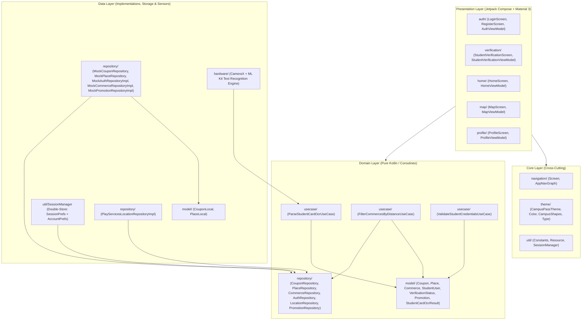

# Arquitectura del Sistema - CampusPass (EstudiHambres)

Documento arquitectónico basado en Clean Architecture y Jetpack Compose según las especificaciones de `PROJECT_RULES.md`.

---

## 1. Diagrama de Capas (Clean Architecture)



---

## 2. Estructura de Paquetes en `app/src/main/java/com/example/estudihambres/`

```
com.example.estudihambres/
│
├── core/                                 # Navegación, Tema y Utilidades transversales
│   ├── navigation/
│   │   ├── Screen.kt                     # Rutas: Login, Register, Home, Map, Verification, Profile
│   │   └── AppNavGraph.kt                # Scaffold + NavigationBar + NavHost con popUpTo anti-fugas
│   ├── theme/
│   │   ├── Color.kt                      # Paleta oficial: #3344EE, #00C853, #FF6D00
│   │   ├── Shape.kt                      # CampusShapes (16.dp estricto en tarjetas)
│   │   ├── Type.kt                       # Material 3 Typography y jerarquías
│   │   └── Theme.kt                      # CampusPassTheme
│   └── util/
│       ├── Constants.kt                  # Radio máximo 30 km, radio terrestre
│       ├── Resource.kt                   # Envoltorio de estados asíncronos (Success, Error, Loading)
│       └── SessionManager.kt             # Gestor doble de persistencia local (sesión activa y cuentas)
│
├── data/                                 # Modelos locales, repositorios mock y sensores
│   ├── model/
│   │   ├── CouponLocal.kt                # Modelo local con mapper .toDomain()
│   │   └── PlaceLocal.kt                 # Modelo local con mapper .toDomain()
│   └── repository/
│       ├── MockCouponRepository.kt       # Repositorio mock de cupones
│       ├── MockPlaceRepository.kt        # Coordenadas y locales reales (Cusco / Lima)
│       ├── MockAuthRepositoryImpl.kt     # Autenticación reactiva vinculada a SessionManager
│       ├── MockCommerceRepositoryImpl.kt # Comercios aliados para testing
│       ├── MockPromotionRepositoryImpl.kt# Beneficios para ti, cerca de ti y tech
│       └── PlayServicesLocationRepositoryImpl.kt # GPS en tiempo real con FusedLocationProviderClient
│
├── domain/                               # Modelos de entidad, contratos y casos de uso puros
│   ├── model/
│   │   ├── Coupon.kt                     # Entidad de cupón universitario
│   │   ├── Place.kt                      # Entidad de establecimiento aliado
│   │   ├── Commerce.kt                   # Entidad comercial con distancia
│   │   ├── Promotion.kt                  # Modelo de beneficio con redirección web oficial
│   │   ├── StudentUser.kt                # Entidad de estudiante con inmutabilidad y avatar
│   │   ├── StudentCardOcrResult.kt       # Resultado detallado de validación de carnet
│   │   └── VerificationStatus.kt         # Enum (VERIFIED, PENDING_VERIFICATION, UNVERIFIED, REJECTED)
│   ├── repository/
│   │   ├── CouponRepository.kt           # Contrato de cupones
│   │   ├── PlaceRepository.kt            # Contrato de lugares geolocalizados
│   │   ├── CommerceRepository.kt         # Contrato de comercios
│   │   ├── PromotionRepository.kt        # Contrato de catálogo de promociones
│   │   ├── AuthRepository.kt             # Contrato de autenticación y carnet
│   │   └── LocationRepository.kt         # Contrato de geolocalización GPS
│   └── usecase/
│       ├── FilterCommercesByDistanceUseCase.kt # Algoritmo Haversine (radio <= 30 km)
│       ├── ParseStudentCardOcrUseCase.kt       # Análisis OCR inteligente multi-sello SUNEDU
│       └── ValidateStudentCredentialsUseCase.kt# Validación estricta de DNI, correo y contraseñas
│
└── presentation/                         # Submódulos UI (Jetpack Compose + StateFlow)
    ├── auth/
    │   ├── LoginScreen.kt                # Login institucional con validación de credenciales
    │   ├── RegisterScreen.kt             # Registro de estudiantes con comprobación de duplicados
    │   └── AuthViewModel.kt              # Lógica de login, registro y bypass desarrollador
    ├── verification/
    │   ├── StudentVerificationScreen.kt  # Visor CameraX embebido con HUD dinámico y anti-recibos
    │   └── StudentVerificationViewModel.kt # Máquina de estados OCR y restricción de carnet único
    ├── home/
    │   ├── HomeScreen.kt                 # Dashboard con carruseles, links oficiales y avatar reactivo
    │   └── HomeViewModel.kt              # Filtrado reactivo, categorización y métricas
    ├── map/
    │   ├── MapScreen.kt                  # Google Maps nativo + Leaflet OSM con navegación turn-by-turn
    │   └── MapViewModel.kt               # Cálculo de distancias y selección de locales aliados
    └── profile/
        ├── ProfileScreen.kt              # Perfil de usuario: DNI/Uni inmutables y cambio de foto
        └── ProfileViewModel.kt           # Persistencia de preferencias, radio GPS y avatar
```

---

## 3. Estado de los Módulos

| Módulo / Agente | Estado | Descripción |
|---|---|---|
| **Agente 1: Arquitectura** | ✅ Producción | Clean Architecture estricta en 4 capas. Cero lógica de negocio en Composable. |
| **Agente 2: UI/UX & Compose** | ✅ Producción | Material 3, esquinas 16.dp, avatar reactivo, carruseles horizontales, paleta corporativa y cero advertencias. |
| **Agente 3: Auth & OCR** | ✅ Producción | Validación estricta de credenciales, estabilización multi-frame (4 frames/1.5s), filtro de recibos comerciales y carnet único por estudiante. |
| **Agente 4: Geolocalización** | ✅ Producción | Google Maps nativo SDK + visor dual OSM/Leaflet, geocodificación real (Cusco/Lima) y navegación turn-by-turn. |
| **Agente 5: QA & Pruebas** | ✅ Producción | Suite de 94 pruebas unitarias aprobadas al 100% (validación, OCR, Haversine, persistencia, inmutabilidad). |
| **Agente 6: GitFlow & Release** | ✅ Producción | `./gradlew testDebugUnitTest assembleDebug` con 0 errores y 0 advertencias. Ramas `develop` y `main` sincronizadas. |

