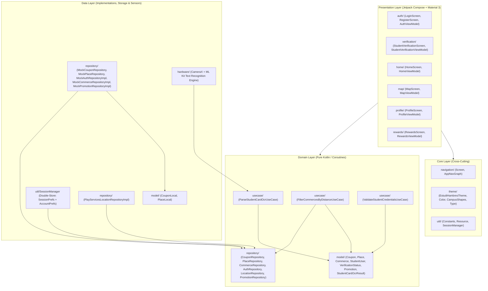

# Arquitectura del Sistema - EstudiHambres

Documento arquitectónico basado en Clean Architecture y Jetpack Compose según las especificaciones de `PROJECT_RULES.md`.

---

## 1. Diagrama de Capas (Clean Architecture)



---

## 2. Estructura de Paquetes en `app/src/main/java/com/example/estudihambres/`

```
com.example.estudihambres/
│
├── core/                                 # Navegación, Tema y Utilidades transversales
│   ├── navigation/
│   │   ├── Screen.kt                     # Rutas: Login, Register, Home, Map, Verification, Profile
│   │   └── AppNavGraph.kt                # Scaffold + NavigationBar + NavHost con popUpTo anti-fugas
│   ├── theme/
│   │   ├── Color.kt                      # Paleta oficial: Obsidiana #09090B, Superficie #141417, Borde #27272A, Naranja Acento #F97316, Esmeralda #10B981
│   │   ├── Shape.kt                      # CampusShapes (16.dp estricto en tarjetas)
│   │   ├── Type.kt                       # Material 3 Typography y jerarquías
│   │   └── Theme.kt                      # EstudiHambresTheme
│   └── util/
│       ├── Constants.kt                  # Radio máximo 30 km, radio terrestre
│       ├── Resource.kt                   # Envoltorio de estados asíncronos (Success, Error, Loading)
│       └── SessionManager.kt             # Gestor doble de persistencia local (sesión activa y cuentas)
│
├── data/                                 # Modelos locales, repositorios mock y sensores
│   ├── model/
│   │   ├── CouponLocal.kt                # Modelo local con mapper .toDomain()
│   │   └── PlaceLocal.kt                 # Modelo local con mapper .toDomain()
│   └── repository/
│       ├── MockCouponRepository.kt       # Repositorio mock de cupones
│       ├── MockPlaceRepository.kt        # Coordenadas y locales reales (Cusco / Lima)
│       ├── MockAuthRepositoryImpl.kt     # Autenticación reactiva vinculada a SessionManager
│       ├── MockCommerceRepositoryImpl.kt # Comercios aliados para testing
│       ├── MockPromotionRepositoryImpl.kt# Beneficios para ti, cerca de ti y tech
│       └── PlayServicesLocationRepositoryImpl.kt # GPS en tiempo real con FusedLocationProviderClient
│
├── domain/                               # Modelos de entidad, contratos y casos de uso puros
│   ├── model/
│   │   ├── Coupon.kt                     # Entidad de cupón universitario
│   │   ├── Place.kt                      # Entidad de establecimiento aliado
│   │   ├── Commerce.kt                   # Entidad comercial con distancia
│   │   ├── Promotion.kt                  # Modelo de beneficio con redirección web oficial
│   │   ├── StudentUser.kt                # Entidad de estudiante con inmutabilidad y avatar
│   │   ├── StudentCardOcrResult.kt       # Resultado detallado de validación de carnet
│   │   └── VerificationStatus.kt         # Enum (VERIFIED, PENDING_VERIFICATION, UNVERIFIED, REJECTED)
│   ├── repository/
│   │   ├── CouponRepository.kt           # Contrato de cupones
│   │   ├── PlaceRepository.kt            # Contrato de lugares geolocalizados
│   │   ├── CommerceRepository.kt         # Contrato de comercios
│   │   ├── PromotionRepository.kt        # Contrato de catálogo de promociones
│   │   ├── AuthRepository.kt             # Contrato de autenticación y carnet
│   │   └── LocationRepository.kt         # Contrato de geolocalización GPS
│   └── usecase/
│       ├── FilterCommercesByDistanceUseCase.kt # Algoritmo Haversine (radio <= 30 km)
│       ├── ParseStudentCardOcrUseCase.kt       # Análisis OCR inteligente multi-sello SUNEDU
│       └── ValidateStudentCredentialsUseCase.kt# Validación estricta de DNI, correo y contraseñas
│
└── presentation/                         # Submódulos UI (Jetpack Compose + StateFlow)
    ├── auth/
    │   ├── LoginScreen.kt                # Login institucional con validación de credenciales
    │   ├── RegisterScreen.kt             # Registro de estudiantes con comprobación de duplicados
    │   └── AuthViewModel.kt              # Lógica de login, registro y bypass desarrollador
    ├── verification/
    │   ├── StudentVerificationScreen.kt  # Visor CameraX embebido con HUD dinámico y anti-recibos
    │   └── StudentVerificationViewModel.kt # Máquina de estados OCR y restricción de carnet único
    ├── home/
    │   ├── HomeScreen.kt                 # Dashboard con carruseles, links oficiales y avatar reactivo
    │   └── HomeViewModel.kt              # Filtrado reactivo, categorización y métricas
    ├── map/
    │   ├── MapScreen.kt                  # Google Maps nativo + Leaflet OSM con navegación turn-by-turn
    │   └── MapViewModel.kt               # Cálculo de distancias y selección de locales aliados
    └── profile/
        ├── ProfileScreen.kt              # Perfil de usuario: DNI/Uni inmutables y cambio de foto
        └── ProfileViewModel.kt           # Persistencia de preferencias, radio GPS y avatar
```

---

## 3. Estado de los Módulos

| Módulo / Agente | Estado | Descripción |
|---|---|---|
| **Agente 1: Arquitectura** | ✅ Producción | Clean Architecture estricta en 4 capas. Cero lógica de negocio en Composable. |
| **Agente 2: UI/UX & Compose** | ✅ Producción | Material 3, esquinas 16.dp, avatar reactivo, carruseles horizontales, paleta corporativa y cero advertencias. |
| **Agente 3: Auth & OCR** | ✅ Producción | Validación estricta de credenciales, estabilización multi-frame (4 frames/1.5s), filtro de recibos comerciales y carnet único por estudiante. |
| **Agente 4: Geolocalización** | ✅ Producción | Google Maps nativo SDK + visor dual OSM/Leaflet, geocodificación real (Cusco/Lima) y navegación turn-by-turn. |
| **Agente 5: QA & Pruebas** | ✅ Producción | Suite de 177 pruebas unitarias aprobadas al 100% en 20 suites (prevención de colisiones Firestore, concurrencia de 10 estudiantes, validación SUNAT, anti-replay multi-usuario, ledger criptográfico SHA-256, anti-XSS, anti-phishing, OCR, Haversine, persistencia). |
| **Agente 6: GitFlow & Release** | ✅ Producción | `./gradlew testDebugUnitTest assembleDebug` con 0 errores. APK generado en `app/build/outputs/apk/debug/app-debug.apk` (69.7 MB). |


---

## 4. Arquitectura de Seguridad y Hardening

El sistema incorpora defensas multicapa diseñadas para entornos universitarios de alta concurrencia:

1. **Prevención Distribuida de Colisiones en la Nube (Cloud Firestore):**
   - Colección inmutable: `claimed_receipts/{receiptFingerprint}`.
   - Huella digital compacta: Primeros 16 caracteres hexadecimales de `SHA-256(RUC-Serie-Correlativo)`.
   - Transacciones atómicas $O(1)$ (`FirebaseFirestore.runTransaction`) con First-Come First-Served garantizado. Si 10 estudiantes intentan registrar la misma boleta física, exactamente 1 la acredita y los otros 9 son rechazados con `COLLISION_DETECTED`.
   - Reglas de seguridad (`firestore.rules`) auditadas con Regex de huella, validación temporal de 72 horas y bloqueo total de mutación o borrado por clientes (`allow update, delete: if false`).

2. **Almacenamiento Criptográfico de Credenciales:**
   - Algoritmo de Hashing: SHA-256 (`SessionManager.hashPassword`).
   - Digest: 64 caracteres hexadecimales deterministas.
   - Migración transparente sin pérdida de sesiones activas.

2. **Control de Concurrencia y Billetera de StudiPuntos:**
   - Bloqueos `@Synchronized` en mutaciones de saldo (`deductStudiPuntos`, `addStudiPuntos`, `setStudiPuntos`, `saveRedeemedReward`).
   - Verificación atómica previa: `if (cost <= 0) return false; if (current < cost) return false`.
   - Prevención matemática y temporal de doble gasto.

3. **Fortificación de WebView en Radar OpenStreetMap:**
   - `settings.allowFileAccess = false` y `settings.allowContentAccess = false`.
   - `settings.setGeolocationEnabled(false)` en Web.
   - `WebViewClient.shouldOverrideUrlLoading` restringido estrictamente a `https://openstreetmap.org` y `https://unpkg.com`.
   - Sanitización bidireccional contra DOM XSS: `sanitizeForJson` (Kotlin) y `escapeHtml` (JavaScript).

4. **Saneamiento de Intents y Despacho de URLs:**
   - Validación de esquema estricto: únicamente `https` y `http`.
   - Inclusión de `Intent.CATEGORY_BROWSABLE` para delegar la navegación exclusivamente a navegadores web autorizados por el sistema operativo.

5. **Cifrado de Tráfico de Red:**
   - Forzado de `android:usesCleartextTraffic="false"` en `AndroidManifest.xml`.
